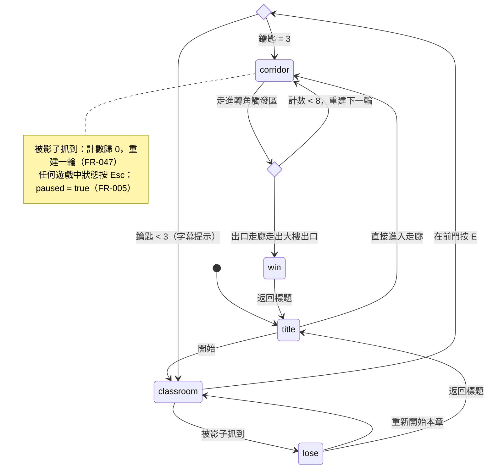

# 《逃出研究室》軟體規格與設計文件（SDD）

| 欄位     | 內容                                                      |
| -------- | --------------------------------------------------------- |
| 專案名稱 | 逃出研究室（Escape the Lab）                              |
| 文件版本 | v1.9                                                      |
| 文件狀態 | 草案（Draft）：第 13 節待釐清事項確認後定為基準版 |
| 作者     | @LIU,XUAN-LIN                                             |
| 建立日期 | 2026-10-19                                                |
| 最後更新 | 2026-10-19                                                |

### 變更紀錄

| 版本   | 日期       | 作者          | 說明                                                                                                                                                                               |
| ------ | ---------- | ------------- | ---------------------------------------------------------------------------------------------------------------------------------------------------------------------------------- |
| v1.0   | 2026-10-19 | @LIU,XUAN-LIN | 初版系統規格書                                                                                                                                                                     |
| v1.1   | 2026-10-19 | @LIU,XUAN-LIN | 改為 SDD 結構：拆分規格／設計／驗證三部分；需求編號化並建立追溯矩陣；修正 v1.0 內部矛盾（第 12 節）與錯字                                                                          |
| v1.1.1 | 2026-10-19 | @LIU,XUAN-LIN | 依 index.html 首版實作同步設計細節：資料模型（playTime、busy）、主迴圈、走廊座標與出口、走廊中的「被看到」判定、A01／A06／A07／A16 實作方式、`?debug` 量測模式；需求（Part I）未變 |
| v1.1.2 | 2026-10-19 | @LIU,XUAN-LIN | 試玩回饋「教室太小、被影子追時跑不掉」：教室放大為 12 m × 10 m 並加寬走道（FR-010）、Shift 快走改為兩章都可用（FR-049、FR-060）；見 D-12 |
| v1.2   | 2026-10-19 | @LIU,XUAN-LIN | 改名為《逃出研究室》並換成研究室主題：第一章「封鎖的研究室」、第二章研究大樓的異常走廊；場景物件、門牌、告示、出口文字隨之更換。玩法、數值、異常種類與判定規則不變；見 D-13 |
| v1.3   | 2026-10-19 | @LIU,XUAN-LIN | 第二章新增 4 種異常（A17 飲水機冷熱、A18 程式輸出錯誤、A19 學生證學校名稱、A20 監視器照著牆壁），異常總數 16 → 20；基準走廊新增程式碼螢幕、學生證、監視器與飲水機冷熱標示（FR-041、FR-054）；見 D-14 |
| v1.4   | 2026-10-19 | @LIU,XUAN-LIN | 學生證內容改為資訊管理研究所（學號 1811531018）；新增 A21「學生證上的系所不對」，異常總數 20 → 21；見 D-15 |
| v1.5   | 2026-10-19 | @LIU,XUAN-LIN | B201 設為系主任辦公室並在門旁加名牌（主任 姜○○）；新增 A22「系主任的姓氏不對」，異常總數 21 → 22；見 D-16 |
| v1.6   | 2026-10-19 | @LIU,XUAN-LIN | 牆上程式碼改為 6 段較難的 Python 程式，每次進入第二章隨機選一段；A18 的錯誤答案改為該程式常見的算錯結果；螢幕放大為 1.62 × 1.1 m；見 D-17 |
| v1.7   | 2026-10-19 | @LIU,XUAN-LIN | 牆上程式碼由 Python 改為 C#（6 段，考點不變），正確輸出以 .NET 10 實際編譯執行驗證；見 D-18 |
| v1.8   | 2026-10-19 | @LIU,XUAN-LIN | 試玩回饋「鬼不夠恐怖」：影子改為長髮遮臉、手臂過膝、穿破爛實驗衣的高瘦人形；看不到時會換姿勢；新增靠近時的呼吸低語、拖行聲、紅色暗角與驚嚇音（FR-037）；抓到時先撲向鏡頭再跳嚇（FR-036）；見 D-19 |
| v1.9   | 2026-10-19 | @LIU,XUAN-LIN | 第一章拿掉畫面上的距離提示（手電筒閃爍、紅色暗角、雜訊），避免旁觀者預知；抓到時改為瞬間顯示滿版恐怖圖片（`assets/恐怖圖片.jpg`，以 base64 嵌入），第一章不再撲向鏡頭；見 D-20、R-05 |

### 文件慣例

- **結構**：Part I「規格」只描述做什麼、為什麼，不寫實作；Part II「設計」描述怎麼做；Part III「驗證與交付」定義測試、追溯與任務。
- **規格先行**：實作與本文件不一致時，先修訂本文件（更新版本與變更紀錄），再修改程式。
- **需求用語**：「須」＝必要（MUST）；「應」＝建議（SHOULD）；「可」＝選用（MAY）。
- **標記**：`[待確認 Q-xx]` 表示該內容為暫定值，對應第 13 節的問題編號。
- **編號規則**：

| 前綴 | 意義       | 前綴 | 意義       |
| ---- | ---------- | ---- | ---------- |
| G    | 設計目標   | C    | 限制       |
| SC   | 成功指標   | A    | 假設       |
| US   | 使用者故事 | R    | 風險       |
| FR   | 功能需求   | D    | 決策紀錄   |
| NFR  | 非功能需求 | Q    | 待釐清事項 |
| TC   | 測試案例   | TASK | 開發任務   |

---

# Part I 　規格（What / Why）

## 1. 簡介

### 1.1 目的

本文件定義《逃出研究室》的需求、系統設計與驗收標準，是開發、測試與課堂展示的唯一依據。

### 1.2 範圍

**範圍內**

- 兩個章節（第一章「封鎖的研究室」、第二章「異常走廊」）的完整遊玩流程。
- 標題、操作說明、暫停、結局、製作名單畫面。
- 程式產生的場景、貼圖與音效；可選用的免費外部素材。
- 課堂展示輔助功能（直接進入走廊、展示提示、強制異常）。

**範圍外**

- 行動裝置、觸控、遊戲手把。
- 多人、連線、排行榜、後端服務。
- 中途存檔（只保存最佳通關時間）。
- 多語系（只提供繁體中文）。
- 建置工具與打包流程。

### 1.3 名詞定義

| 名詞           | 定義                                                   |
| -------------- | ------------------------------------------------------ |
| 章節           | 第一章「封鎖的研究室」與第二章「異常走廊」                 |
| 輪（Round）    | 在走廊中從入口出發，走到任一轉角觸發判定為止的一次嘗試 |
| 計數（streak） | 走廊連續答對次數，範圍 0–8                             |
| 基準走廊       | 不含任何異常的走廊版本，所有異常都相對於它定義         |
| 異常           | 與基準走廊不同的一處變化                               |
| 影子           | 只在未被手電筒照到時移動的怪物                         |
| 光圈           | 手電筒照亮的螢幕圓形範圍，圓外畫面全黑                 |
| 集光           | 按住滑鼠左鍵，使光圈縮小、照射距離加倍                 |
| 被照到         | 影子符合 FR-031 的判定條件                             |
| 觸發區         | 走廊兩端轉角處不可見的判定區域                         |
| 直接進入走廊   | 標題畫面按鈕，跳過第一章、直接進入第二章               |
| 展示提示       | 以 H 鍵切換的輔助顯示，讓老師或觀眾對答案              |

### 1.4 參考資料

- 《8 號出口》（KOTAKE CREATE）：異常走廊玩法參考。
- three.js r160 文件：<https://threejs.org/docs/>
- 第 9.3 節列出的免費素材網站。

## 2. 產品概述

### 2.1 核心概念

《逃出研究室》是一款以 three.js 製作、單一 index.html 即可執行的第一人稱研究所恐怖解謎遊戲，融合「異常走廊（8 號出口風格）」與「手電筒探索」兩種玩法，單局約 10–15 分鐘。

深夜加班時，研究大樓突然斷電，玩家被困在自己的研究室裡。玩家先在全黑的研究室用手電筒找齊三把鑰匙、打開被上鎖的研究室門，接著進入無限重複的研究大樓走廊，必須連續 8 次正確判斷「有沒有異常」才能從大樓出口逃出。手電筒與「只在暗處移動的東西」貫穿兩個章節，讓兩種玩法成為同一個世界的兩個階段。

### 2.2 產品資訊

| 項目     | 內容                                                  |
| -------- | ----------------------------------------------------- |
| 遊戲名稱 | 逃出研究室（Escape the Lab）                 |
| 類型     | 第一人稱、恐怖、觀察解謎                              |
| 平台     | 桌上型電腦瀏覽器（鍵盤 + 滑鼠）                       |
| 交付物   | 單一 index.html（HTML + CSS + JavaScript + three.js） |
| 遊玩時間 | 10–15 分鐘／局                                        |
| 目標情境 | 課堂作業展示：投影在大螢幕上，台下觀眾一起找異常      |

### 2.3 設計目標

| 編號 | 目標                                                                      |
| ---- | ------------------------------------------------------------------------- |
| G-01 | 規則一句話講得完：「找鑰匙開門」、「有異常就回頭，沒異常就往前」          |
| G-02 | 展示時有話題性：異常要讓台下觀眾能一起喊出來                              |
| G-03 | 製造緊張感：黑暗、有限視野、會逼近的怪物                                  |
| G-04 | 零安裝：單一 index.html，以靜態伺服器開啟即可遊玩，不需建置工具或另裝素材 |

### 2.4 目標使用者與使用情境

- **主要情境：課堂展示**。展示者在投影大螢幕上操作，台下觀眾一起找異常；時間有限，需要能跳過第一章並對答案。
- **次要情境：個人遊玩**。同學用自己的筆電從頭玩完兩章。

### 2.5 成功指標

SC-01–SC-03 的門檻為 v1.1 新增的建議值 `[待確認 Q-10]`。

| 編號  | 指標     | 量測方式與門檻                                                 | 對應目標 |
| ----- | -------- | -------------------------------------------------------------- | -------- |
| SC-01 | 規則易懂 | 5 位新玩家只看大樓守則告示，至少 4 位在前 3 輪內做出符合規則的判斷 | G-01     |
| SC-02 | 單局時間 | 試玩者完整一局的中位數落在 10–15 分鐘                          | 2.2      |
| SC-03 | 觀眾參與 | 課堂展示時，「明顯」級異常出現後 10 秒內有觀眾喊出             | G-02     |
| SC-04 | 流暢度   | 一般筆電內顯平均 ≥ 55 FPS（同 NFR-005）                        | G-03     |
| SC-05 | 零安裝   | 只需 index.html 與靜態伺服器即可遊玩，Console 無錯誤           | G-04     |

## 3. 使用者故事與驗收情境

優先級：P1 ＝ 展示必備；P2 ＝ 體驗核心；P3 ＝ 完整度。每個故事都能單獨開發、單獨驗證。

### US-01 　異常走廊判斷（P1）

身為玩家，我想在重複的走廊中判斷有沒有異常，再決定往前或回頭，以便連續答對 8 次從大樓出口逃出。

- **獨立驗證**：標題畫面按「直接進入走廊」即可單獨測試。
- **驗收情境**
  1. **Given** 首次進入走廊（計數 0），**When** 觀察整條走廊，**Then** 不含任何異常。
  2. **Given** 本輪有異常，**When** 玩家回頭走出入口轉角，**Then** 進度牌數字 +1。
  3. **Given** 本輪無異常，**When** 玩家回頭走出入口轉角，**Then** 進度牌歸 0。
  4. **Given** 計數 7 且本輪判斷正確，**When** 進入下一輪，**Then** 前方轉角變成大樓出口；走出大樓出口即顯示勝利畫面。

### US-02 　手電筒找鑰匙（P1）

身為玩家，我想在全黑的研究室中用滑鼠光圈搜尋三把鑰匙並開門，以便進入走廊。

- **獨立驗證**：按「開始」進入第一章，不需走廊即可測試。
- **驗收情境**
  1. **Given** 研究室開局，**When** 移動滑鼠，**Then** 光圈跟著游標，光圈外全黑。
  2. **Given** 鑰匙在光圈內且距離 ≤ 2 m，**When** 按 E，**Then** 鑰匙消失，HUD 對應顏色的圖示點亮。
  3. **Given** 鑰匙距離 > 2 m，**When** 按 E，**Then** 無法拾取。
  4. **Given** 持有鑰匙少於 3 把，**When** 在前門按 E，**Then** 顯示字幕「門上有三道鎖。」，門不打開。
  5. **Given** 持有 3 把鑰匙，**When** 在前門按 E，**Then** 黑幕過場後進入第二章。

### US-03 　影子威脅（P2）

身為玩家，我想面對一個只在暗處移動、而且越來越快的影子，以便感受到緊張與壓迫。

- **驗收情境**
  1. **Given** 影子被光圈照到，**Then** 影子完全靜止；連續照射 3 秒後瞬移到別處暗處。
  2. **Given** 影子躲在桌子後面，**When** 光圈對準它，**Then** 視為未照到，影子繼續移動。
  3. **Given** 影子距離 < 4 m，**Then** 手電筒閃爍、心跳聲出現且隨距離加快。
  4. **Given** 在研究室中影子距離 < 1.2 m，**Then** 跳嚇畫面與尖叫，接著顯示失敗畫面，可重開第一章。
  5. **Given** 在走廊中被影子抓到，**Then** 跳嚇後計數歸 0，重新開始一輪。

### US-04 　課堂展示輔助（P2）

身為展示者，我想跳過研究室、顯示答案並指定異常，以便在有限的課堂時間內展示重點並讓觀眾對答案。

- **驗收情境**
  1. **Given** 在標題畫面，**When** 按「直接進入走廊」，**Then** 以計數 0 進入走廊。
  2. **Given** 在走廊中，**When** 按 H，**Then** 畫面顯示本輪是否有異常與異常名稱；再按一次則隱藏。
  3. **Given** 展示提示開啟，**When** 按指定鍵切換異常，**Then** 下一輪強制套用該異常。

### US-05 　結局與紀錄（P3）

身為玩家，我想在通關後看到成績並保留最佳紀錄，以便和同學比較。

- **驗收情境**
  1. **Given** 通關，**Then** 勝利畫面顯示通關時間、答錯次數、看過的異常數／22；若優於最佳紀錄則保存。
  2. **Given** 瀏覽器封鎖本機儲存，**Then** 遊戲仍可正常遊玩，只是不保存紀錄。

### US-06 　音效氛圍（P3）

身為玩家，我想聽到環境音與距離提示音，以便沉浸並判斷危險。

- **驗收情境**
  1. **Given** 按下「開始」，**Then** 環境嗡音開始播放。
  2. **Given** 靠近掛鐘 6 m 內，**Then** 聽到時鐘滴答聲。

## 4. 功能需求

### 4.1 遊戲流程

| 編號   | 需求                                                                                                                          | 來源         |
| ------ | ----------------------------------------------------------------------------------------------------------------------------- | ------------ |
| FR-001 | 系統須提供標題畫面，包含「開始」「操作說明」「直接進入走廊」按鈕，並顯示最佳通關時間；使用 CC-BY 素材時須另有「製作名單」入口 | US-04、US-05 |
| FR-002 | 按「開始」須進入第一章，並在此時啟用音效                                                                                      | US-02、US-06 |
| FR-003 | 第一章開門後，須以黑幕過場進入第二章，計數為 0                                                                                | US-02        |
| FR-004 | 按「直接進入走廊」須跳過第一章，以計數 0 進入第二章                                                                           | US-04        |
| FR-005 | 遊戲進行中按 Esc 須暫停：遊戲邏輯、影子與計時全部停止；按「繼續」後回到暫停前的狀態                                           | —            |
| FR-006 | 通關須顯示勝利畫面；第一章被抓須顯示失敗畫面（FR-036）；勝利或失敗畫面都可返回標題                                            | US-03、US-05 |

### 4.2 第一章：封鎖的研究室

| 編號   | 需求                                                                                                                                                       | 來源  |
| ------ | ---------------------------------------------------------------------------------------------------------------------------------------------------------- | ----- |
| FR-010 | 研究室 12 m × 10 m，包含主實驗台、白板、實驗桌椅 5 排 × 6 行（部分倒地）、後方試劑櫃、百葉窗、前後兩扇門；後門封死，前門有紅、藍、黃三道鎖。行與行之間的走道約 1.1 m，排與排之間須留出可橫向穿越的通道；倒地的桌椅不得完全堵住走道 | US-02、US-03 |
| FR-011 | 研究室須幾乎全黑，只看得到窗外微弱的月光輪廓，畫面內容主要靠手電筒照亮                                                                                       | US-02 |
| FR-012 | 每局須從 8 個候選藏匙點（主實驗台抽屜、倒地的椅子旁、試劑櫃、百葉窗後、廢液桶旁、白板下、後排實驗桌、防護衣櫃）隨機抽 3 個不重複的位置，分別放置紅、藍、黃鑰匙各一把 | US-02 |
| FR-013 | 鑰匙只在被光圈照到時閃動發光                                                                                                                               | US-02 |
| FR-014 | 拾取條件：鑰匙在光圈內、與玩家距離 ≤ 2 m、按 E，三者同時成立；可拾取時，游標旁須顯示「[E] 拾取」                                                           | US-02 |
| FR-015 | 玩家以 WASD 移動，速度 2.2 m/s，不可穿過桌椅與牆壁                                                                                                         | US-02 |
| FR-016 | 持有 3 把鑰匙並在前門 1.5 m 內按 E 須開門 `[待確認 Q-08]`；不足 3 把時，顯示字幕「門上有三道鎖。」                                                         | US-02 |
| FR-017 | 第一章被抓後可重新開始本章：鑰匙數歸 0，重新抽取藏匙點與影子位置                                                                                           | US-03 |

### 4.3 手電筒

| 編號   | 需求                                                              | 來源  |
| ------ | ----------------------------------------------------------------- | ----- |
| FR-020 | 第一章不鎖定滑鼠，游標位置就是手電筒的照射點                      | US-02 |
| FR-021 | 光圈半徑 120 px，圓心跟著游標，光圈外的畫面須完全黑               | US-02 |
| FR-022 | 游標在螢幕左右邊緣 10% 範圍內時，視角以 60°/秒朝該側轉動          | US-02 |
| FR-023 | 按住滑鼠左鍵集光：光圈半徑縮為 70 px，照射距離加倍（12 m → 24 m） | US-02 |
| FR-024 | 第二章鎖定滑鼠以轉動視角；手電筒固定照向畫面中心，按 F 開關       | US-01 |
| FR-025 | 第二章中影子距離 < 4 m 時，手電筒須閃爍；第一章不閃爍（不顯示任何距離提示，D-20） | US-03 |

### 4.4 影子

| 編號   | 需求                                                                                                                                                   | 來源  |
| ------ | ------------------------------------------------------------------------------------------------------------------------------------------------------ | ----- |
| FR-030 | 開局時，影子須在離玩家最遠的角落生成                                                                                                                   | US-03 |
| FR-031 | 「被照到」判定：影子的頭部或胸口任一點同時滿足（a）在攝影機前方；（b）螢幕投影點與光圈圓心距離 < 光圈半徑；（c）攝影機到該點的視線沒有被桌椅或牆壁擋住 | US-03 |
| FR-032 | 被照到時須完全靜止並暫停加速計時 `[待確認 Q-07]`；連續被照到超過 3 秒，須瞬移到玩家視線外的另一處暗處                                                  | US-03 |
| FR-033 | 未被照到時，須朝玩家移動並能繞過桌椅                                                                                                                   | US-03 |
| FR-034 | 移動速度 ＝ 0.6 m/s ×（1 + 0.35 × 已拿鑰匙數）×（1 + 0.1 × ⌊加速計時秒數 ÷ 30⌋），上限 2.0 m/s `[待確認 Q-02、Q-03]`                                   | US-03 |
| FR-035 | 距離 < 4 m 須播放心跳聲，心跳間隔隨距離縮短；第二章另外讓手電筒閃爍（第一章只有聲音，畫面不提示）                                                                                      | US-03 |
| FR-036 | 距離 < 1.2 m 即抓到玩家：第一章在同一瞬間顯示滿版恐怖圖片並尖叫，事前沒有任何畫面預兆；第二章影子先撲向鏡頭（約 0.5 秒，畫面晃動、臉部被紅光照亮），再顯示同一張滿版恐怖圖片與尖叫；第一章接著顯示失敗畫面「它抓到你了」，第二章依 FR-047 處理                                                | US-03 |
| FR-037 | 恐怖提示：（a）影子在玩家看不到時會改變姿勢（歪頭、伸手等），每次重新被照到姿勢都不同，但被照到時仍須完全靜止（FR-032）；（b）距離 < 7 m 時播放呼吸與低語，移動時有拖行聲，聲音依影子方向左右定位；（c）第二章中紅色暗角與畫面噪點隨距離增強（第一章不顯示）；（d）影子消失 1.5 秒以上後在 5 m 內重新被照到，播放驚嚇音效，冷卻 6 秒 | US-03 |

### 4.5 第二章：異常走廊

| 編號   | 需求                                                                                                                                    | 來源  |
| ------ | --------------------------------------------------------------------------------------------------------------------------------------- | ----- |
| FR-040 | 走廊為長 40 m、寬 4 m、高 3.2 m 的直線，兩端各接一個 L 型轉角，轉角後接回下一輪走廊的起點，形成無限迴圈                                 | US-01 |
| FR-041 | 基準走廊須包含：左側研究室門 3 間（門牌 B201、B202、B203；B201 為系主任辦公室，門旁名牌寫「資訊管理系 系主任辦公室 主任 姜○○」）、右側窗戶 6 扇、公告欄海報 2 張、掛鐘 1 個、滅火器 1 個、日光燈 8 支、飲水機 1 台（左「熱」紅色、右「冷」藍色兩個出水口）、牆上程式碼螢幕 1 台（顯示一段 C# 程式與正確的執行結果；每次進入第二章從 6 段中隨機選一段，同一局內不變）、地上一張「國立臺中科技大學」學生證（系所「資訊管理研究所 碩一」、學號 1811531018）、牆上監視器 1 台（朝向走廊入口） | US-01 |
| FR-042 | 走廊入口須有進度牌，顯示目前計數（0–7），對應 8 號出口的數字招牌                                                                        | US-01 |
| FR-043 | 走廊入口須貼大樓守則告示，以文字寫明規則，投影時觀眾也看得清楚                                                                              | US-01 |
| FR-044 | 判定規則如下表；答錯時答錯次數 +1                                                                                                       | US-01 |
| FR-045 | 玩家走進轉角觸發區即判定；判定後黑幕 0.6 秒，重建下一輪，玩家回到新一輪的入口                                                           | US-01 |
| FR-046 | 不得以文字顯示「對」或「錯」，結果只反映在進度牌數字的變化                                                                              | US-01 |
| FR-047 | 走廊中被影子抓到：跳嚇後計數歸 0、重建一輪，不顯示失敗畫面，也不計入答錯次數 `[待確認 Q-12]`                                            | US-03 |
| FR-048 | 計數達 8 時，下一輪須為出口走廊：沒有異常，前方轉角改為大樓出口，入口轉角封閉 `[待確認 Q-09]`；走出大樓出口即勝利                               | US-01 |
| FR-049 | 兩章都可按住 Shift 快走，速度為一般移動的 1.6 倍（研究室中用來甩開影子）                                                                  | US-01、US-03 |

**FR-044 判定規則表**

| 本輪狀態 | 玩家行為                       | 結果           |
| -------- | ------------------------------ | -------------- |
| 有異常   | 回頭（往來時方向走出入口轉角） | 正確，計數 +1  |
| 有異常   | 往前（走出前方轉角）           | 錯誤，計數歸 0 |
| 無異常   | 往前                           | 正確，計數 +1  |
| 無異常   | 回頭                           | 錯誤，計數歸 0 |

### 4.6 異常

| 編號   | 需求                                                                               | 來源  |
| ------ | ---------------------------------------------------------------------------------- | ----- |
| FR-050 | 每次進入第二章後的第一輪須為基準走廊，讓玩家記住正常樣子 `[決策 D-09]`             | US-01 |
| FR-051 | 其餘每輪有 60% 機率出現異常，每輪最多 1 個                                         | US-01 |
| FR-052 | 異常須從尚未出現過的池中抽取；池抽完才重置，而且重置後抽到的第一個不得與上一個相同 | US-01 |
| FR-053 | 依計數限制難度：計數 0–2 只抽「明顯」；3–5 加入「中等」；6–7 加入「細微」          | US-01 |
| FR-054 | 須實作第 8.5 節的 22 種異常，難度分布為明顯 5、中等 8、細微 9                      | US-01 |
| FR-055 | 每輪建立時須先還原所有異常，確保未抽中的物件與基準走廊完全相同                     | US-01 |

### 4.7 操作與介面

**FR-060 操作對照**

| 輸入             | 第一章 封鎖的研究室              | 第二章 異常走廊              |
| ---------------- | ---------------------------- | ---------------------------- |
| W A S D          | 移動                         | 移動                         |
| Shift            | 快走（1.6 倍）               | 快走（1.6 倍）               |
| 滑鼠移動         | 移動手電筒光圈；靠邊緣轉視角 | 轉動視角（滑鼠鎖定）         |
| 滑鼠左鍵（按住） | 集光                         | —                            |
| E                | 拾取鑰匙／開門               | —                            |
| F                | —                            | 開關手電筒                   |
| Esc              | 暫停                         | 暫停（同時解除滑鼠鎖定）     |
| H                | 展示提示 `[待確認 Q-04]`     | 展示提示：顯示本輪是否有異常 |

| 編號   | 需求                                                                                           | 來源  |
| ------ | ---------------------------------------------------------------------------------------------- | ----- |
| FR-061 | 第一章 HUD：左上角三個鑰匙圖示，未取得為灰色外框，取得後顯示該鑰匙顏色                         | US-02 |
| FR-062 | 第二章 HUD：不顯示分數，計數只出現在場景內的進度牌；畫面中心顯示 4 px 準心                     | US-01 |
| FR-063 | 畫面下方須有字幕區，用於劇情旁白（例：「門上有三道鎖。」），每句顯示 3 秒後淡出                | US-02 |
| FR-064 | 勝利畫面顯示通關時間、答錯次數、看過的異常數／22；失敗畫面顯示「它抓到你了」與「重新開始本章」 | US-05 |
| FR-065 | 文字為白色加黑色陰影，在投影環境下清楚可讀                                                     | G-02  |
| FR-066 | 視窗大小改變時，畫面須即時調整比例，不得變形或裁切 HUD                                         | —     |

### 4.8 音效

| 編號   | 需求                                                                                       | 來源  |
| ------ | ------------------------------------------------------------------------------------------ | ----- |
| FR-070 | 須提供環境嗡音、腳步聲、時鐘滴答、心跳、拾取／解鎖、尖叫、影子呼吸低語、影子拖行聲、驚嚇音 9 種音效，觸發時機見第 8.7 節 | US-06 |
| FR-071 | 音效須在玩家第一次互動（按「開始」或「直接進入走廊」）之後才啟用，以符合瀏覽器自動播放限制 | US-06 |

### 4.9 展示輔助

| 編號   | 需求                                                                                                     | 來源  |
| ------ | -------------------------------------------------------------------------------------------------------- | ----- |
| FR-080 | 按 H 切換展示提示；第二章顯示本輪是否有異常與異常名稱；第一章的顯示內容 `[待確認 Q-04]`                  | US-04 |
| FR-081 | 展示提示開啟時，可用數字鍵或 [ ] 鍵依編號切換，強制指定下一輪的異常，以便逐一檢查全部 22 種異常（v1.1 新增） | US-04 |
| FR-082 | 展示提示不得改變判定結果與計數                                                                           | US-04 |

### 4.10 紀錄

| 編號   | 需求                                                                                                       | 來源  |
| ------ | ---------------------------------------------------------------------------------------------------------- | ----- |
| FR-090 | 通關時須保存最佳通關時間，只保存這一項                                                                     | US-05 |
| FR-091 | 通關時間 ＝ 從按「開始」到走出大樓出口，不含暫停時間；以「直接進入走廊」開始的局不保存最佳紀錄 `[待確認 Q-05]` | US-05 |
| FR-092 | 本機儲存無法使用時（私密模式、封鎖網站資料），遊戲須正常運作                                               | US-05 |

## 5. 非功能需求

| 編號    | 類別     | 需求                                                                                           | 驗證     |
| ------- | -------- | ---------------------------------------------------------------------------------------------- | -------- |
| NFR-001 | 交付     | 所有 HTML、CSS、JavaScript 放在單一 index.html；若使用外部素材，須以 base64 嵌入               | TC-01    |
| NFR-002 | 相依     | three.js 固定為 r160，經 CDN 載入；不使用其他第三方函式庫                                      | 程式審查 |
| NFR-003 | 相容性   | 支援 Chrome／Edge 120+、Firefox 120+、Safari 17+（需支援 importmap 與 WebGL2）                 | TC-01    |
| NFR-004 | 解析度   | 1280×720 以上的視窗都能正常顯示與操作                                                          | TC-19    |
| NFR-005 | 效能     | 一般筆電內顯平均 ≥ 55 FPS（目標 60）；draw call < 150、三角形 < 100k                           | TC-02    |
| NFR-006 | 穩定性   | 切換分頁再回來時，角色與影子不得瞬移                                                           | TC-13    |
| NFR-007 | 資源     | 章節切換須釋放舊章節資源；反覆重開 10 次後，記憶體不得持續上升                                 | TC-18    |
| NFR-008 | 檔案大小 | 外部素材每個模型 ≤ 1 MB，總量 ≤ 10 MB                                                          | 程式審查 |
| NFR-009 | 可靠性   | 外部素材載入失敗時，須退回程式產生的幾何，遊戲仍可遊玩                                         | TC-21    |
| NFR-010 | 可維護性 | 新增異常只需新增一筆異常定義，不需修改走廊或判定邏輯                                           | 程式審查 |
| NFR-011 | 授權     | 只使用 CC0、CC-BY 或免費商用素材；CC-BY 素材須在製作名單與作業報告列出作品名、作者、授權與連結 | 程式審查 |
| NFR-012 | 品質     | 正常遊玩全程，Console 沒有錯誤或未處理的例外                                                   | TC-01    |

## 6. 限制、假設、相依與風險

### 6.1 限制

| 編號 | 限制                                                                                             |
| ---- | ------------------------------------------------------------------------------------------------ |
| C-01 | 交付物只能是單一 index.html（作業要求）                                                          |
| C-02 | 不使用建置工具（webpack、Vite 等）                                                               |
| C-03 | ES Module 在部分瀏覽器不支援 `file://`，須用 VS Code Live Server 或 `npx serve` 等靜態伺服器開啟 |

### 6.2 假設

| 編號 | 假設                                                           |
| ---- | -------------------------------------------------------------- |
| A-01 | 展示與遊玩時有網路連線，可從 CDN 載入 three.js `[待確認 Q-11]` |
| A-02 | 展示設備為 1080p 投影機，搭配鍵盤與滑鼠                        |
| A-03 | 單人遊玩，同一時間只有一位操作者                               |

### 6.3 相依

- three.js r160（jsDelivr CDN）及其擴充模組 `PointerLockControls`；使用外部模型時另需 `GLTFLoader`。
- 瀏覽器 API：WebGL2、Web Audio API、Pointer Lock API、localStorage。

### 6.4 風險

| 編號 | 風險                                      | 影響                   | 緩解措施                                             |
| ---- | ----------------------------------------- | ---------------------- | ---------------------------------------------------- |
| R-01 | 展示教室網路中斷，CDN 載入失敗              | 無法遊玩               | 展示前實機測試；準備內嵌 three.js 的備用版本（Q-11） |
| R-02 | 投影太暗，觀眾看不到細微異常              | 降低話題性（G-02）     | 展示前調整投影亮度；必要時用展示提示                 |
| R-03 | 手電筒即時陰影拖慢效能                    | 低於 NFR-005           | 陰影貼圖限 1024×1024；日光燈不開陰影                 |
| R-04 | 22 種異常的還原有遺漏，造成下一輪殘留異常 | 判定錯亂，破壞遊戲規則 | FR-055 每輪先全部還原；TC-11 逐一檢查                |
| R-05 | 跳嚇用的 `assets/恐怖圖片.jpg` 為使用者提供、授權不明（疑似電影劇照），與 NFR-011 衝突 | 公開發布（例如 GitHub Pages）可能侵權 | 課堂內展示前先確認授權；公開發布前改用自行繪製或 CC0 圖片 |

---

# Part II 　設計（How）

## 7. 系統架構

### 7.1 技術堆疊

| 項目     | 規格                                                                   | 對應需求       |
| -------- | ---------------------------------------------------------------------- | -------------- |
| 檔案     | 單一 index.html，內含 `<style>` 與 `<script type="module">`            | NFR-001        |
| 3D 引擎  | three.js r160（固定版本），以 importmap 從 jsDelivr 載入               | NFR-002        |
| 擴充模組 | `three/addons/controls/PointerLockControls.js`（第二章的第一人稱視角） | FR-024         |
| 貼圖     | `CanvasTexture`：用 2D Canvas 繪製海報、時鐘面、地板、白板、門牌       | NFR-001        |
| 音效     | Web Audio API 即時合成                                                 | FR-070         |
| 儲存     | `localStorage` 只存最佳通關時間；讀寫都包在 try/catch                  | FR-090、FR-092 |
| 執行方式 | VS Code Live Server 或 `npx serve`                                     | C-03           |

### 7.2 index.html 內部結構

```html
<!DOCTYPE html>
<html lang="zh-Hant">
  <head>
    <meta charset="utf-8" />
    <title>逃出研究室</title>
    <style>
      /* HUD、選單、手電筒遮罩、暗角與噪點、過場黑幕、字幕 */
    </style>
    <script type="importmap">
      {
        "imports": {
          "three": "https://cdn.jsdelivr.net/npm/three@0.160.0/build/three.module.js",
          "three/addons/": "https://cdn.jsdelivr.net/npm/three@0.160.0/examples/jsm/"
        }
      }
    </script>
  </head>
  <body>
    <canvas id="game"></canvas>
    <div id="flashlight-mask"></div>
    <!-- 第一章光圈遮罩 -->
    <div id="hud">...</div>
    <!-- 鑰匙數、準心、提示文字、展示提示 -->
    <div id="subtitle"></div>
    <div id="menu">...</div>
    <!-- 標題／操作說明／暫停／結局／製作名單 -->
    <script type="module">
      /* 第 7.3 節的所有模組 */
    </script>
  </body>
</html>
```

### 7.3 模組劃分

程式分成 10 個模組（同一個 `<script type="module">` 內的類別或物件）。`Game` 持有共用的 renderer 與主迴圈；兩個章節都實作 7.4 節的 `Level` 介面。

| 模組           | 職責                                      | 主要方法                                            | 對應需求           |
| -------------- | ----------------------------------------- | --------------------------------------------------- | ------------------ |
| Game           | 建立 renderer、攝影機、主迴圈；切換狀態   | `start()`、`setState(name)`、`pause()`、`loop()`    | FR-001–006         |
| Input          | 鍵盤／滑鼠狀態、滑鼠鎖定                  | `isDown(key)`、`mouseNDC`、`lock()`、`unlock()`     | FR-060             |
| Player         | 位置、移動、AABB 碰撞、腳步計距           | `update(dt, colliders)`、`reset(spawn)`             | FR-015、FR-049     |
| Flashlight     | SpotLight、CSS 遮罩、集光、閃爍、照到判定 | `aimAt(ndc)`、`isLit(point)`、`setFocus(on)`        | FR-020–025、FR-031 |
| ClassroomLevel | 研究室幾何、鑰匙生成與拾取、開門            | `enter()`、`update(dt)`、`exit()`                   | FR-010–017         |
| Stalker        | 影子模型、BFS 尋路、照射凍結、瞬移、抓人  | `update(dt, player, flashlight)`、`spawnFarthest()` | FR-030–036         |
| CorridorLevel  | 走廊幾何、觸發區、計數、重建、出口        | `buildRound()`、`judge(direction)`                  | FR-040–049         |
| AnomalyManager | 異常池、依難度抽取、套用／還原、強制指定  | `pick(streak)`、`revertAll(level)`、`force(id)`     | FR-050–055、FR-081 |
| UI             | HUD、選單、字幕、過場黑幕、展示提示       | `update(state)`、`showSubtitle(text)`、`fade(ms)`   | FR-061–066、FR-080 |
| AudioFX        | Web Audio 合成與播放                      | `init()`、`play(name)`、`setHeartbeat(distance)`    | FR-070–071         |

### 7.4 介面契約

```js
/**
 * 章節介面：ClassroomLevel 與 CorridorLevel 都須實作。
 * @typedef {Object} Level
 * @property {THREE.Scene} scene        每個章節使用自己的 Scene
 * @property {THREE.Box3[]} colliders   供 Player 做 AABB 碰撞
 * @property {() => void} enter         建立場景並重置章節狀態
 * @property {(dt: number) => void} update
 * @property {() => void} exit          dispose geometry / material / texture（NFR-007）
 */

/**
 * 異常介面（D-03：統一以 level 為參數）。
 * @typedef {Object} Anomaly
 * @property {string} id                 "A01"–"A22"
 * @property {string} name               展示提示顯示的名稱
 * @property {1|2|3} level               1 明顯／2 中等／3 細微
 * @property {(level: CorridorLevel) => void} apply
 * @property {(level: CorridorLevel) => void} revert  須完全還原 apply 的所有變更
 */
```

### 7.5 資料模型

```js
const state = {
  scene: "title", // title | classroom | corridor | win | lose
  paused: false, // 獨立旗標，恢復時回到 scene（D-04）
  busy: false, // 過場、跳嚇、開門動畫期間暫停邏輯更新
  keys: 0, // 0–3
  streak: 0, // 走廊連續答對次數 0–8
  isFirstRound: true, // FR-050
  currentAnomaly: null, // 本輪異常物件或 null
  forcedAnomalyId: null, // FR-081：下一輪強制套用的異常，用過即清除
  forcedIndex: -1, // [ ] 鍵切換時的游標
  seenAnomalies: new Set(),
  mistakes: 0,
  playTime: 0, // FR-091：只在遊戲進行中累加，自然排除暫停與過場
  skippedClassroom: false, // FR-091：直接進入走廊的局
  hintVisible: false, // H 鍵展示提示（D-05）
};

const anomaly = {
  id: "A02",
  name: "時鐘倒著走",
  level: 2,
  apply(level) {
    level.clock.direction = -1;
  },
  revert(level) {
    level.clock.direction = 1;
  },
};
```

**可調參數集中管理**：所有數值集中在 `CONFIG`，調整手感時只改這裡，並同步更新本文件。

```js
const CONFIG = {
  maxDt: 0.05, // NFR-006
  eyeHeight: 1.6,
  player: { speed: 2.2, sprintMul: 1.6, stepDist: 0.6, radius: 0.25 },
  flashlight: {
    radiusPx: 120,
    focusRadiusPx: 70,
    distance: 12,
    angle: 0.35,
    penumbra: 0.4,
    intensity: 40,
    edgeTurn: 0.1,
    turnSpeedDeg: 60,
  },
  key: { pickupDist: 2, doorDist: 1.5 },
  stalker: {
    baseSpeed: 0.6,
    perKey: 0.35,
    accelEvery: 30,
    accelStep: 0.1,
    maxSpeed: 2.0,
    warnDist: 4,
    catchDist: 1.2,
    freezeTeleport: 3,
    gridSize: 0.5,
    teleportMinDist: 5,
  },
  corridor: {
    length: 40,
    longLength: 52,
    height: 3.2,
    lowHeight: 2.5,
    fadeSec: 0.6,
    anomalyChance: 0.6,
    goal: 8,
    lightIntensity: 22,
    hemiIntensity: 0.3,
  },
  subtitleSec: 3,
};
```

- 拾取距離以玩家與鑰匙的水平距離計算（地上的鑰匙才拿得到）。

### 7.6 狀態機



- 6 個狀態：`title`、`classroom`、`corridor`、`win`、`lose`，加上覆蓋在遊戲狀態上的 `paused` 旗標。
- 2 個判斷：鑰匙是否滿 3 把、計數是否達 8。
- 第二章按 Esc 時，瀏覽器會先解除滑鼠鎖定；以 `pointerlockchange` 事件偵測並進入暫停。恢復時須由玩家點擊「繼續」重新鎖定滑鼠（瀏覽器要求使用者手勢）。
- 進入第二章時先顯示「第二章　異常走廊」說明畫面（狀態為 `paused`），玩家點擊「點擊開始」鎖定滑鼠後才開始；理由同上。

### 7.7 主迴圈與章節生命週期

```js
function loop() {
  requestAnimationFrame(loop);
  const dt = Math.min(clock.getDelta(), CONFIG.maxDt); // 防止切分頁後瞬移（NFR-006）
  const playing = game.isInGame() && !state.paused && !state.busy;
  if (playing && game.current) {
    state.playTime += dt;
    game.current.update(dt); // 章節內依序呼叫 player.update → flashlight.update → 鑰匙／影子／觸發區
  }
  updateTweens(dt); // 開門等補間動畫在過場期間也要播放
  audio.update(playing ? dt : 0); // 心跳
  ui.update(dt);
  if (game.current) renderer.render(game.current.scene, camera);
  else renderer.clear();
  input.endFrame();
}
```

- `player.update` 與 `flashlight.update` 由各章節的 `update()` 呼叫，因為兩章的視角控制不同（研究室靠游標邊緣轉向、走廊靠滑鼠鎖定），且手電筒射線必須在玩家移動後才計算。
- 切換章節的順序：`ui.fadeTo(1)` 黑幕 → 舊章節 `exit()` 釋放資源 → 新章節 `enter()` → `ui.fadeTo(0)` 黑幕淡出；期間 `state.busy = true`。

## 8. 詳細設計

### 8.1 第一章：封鎖的研究室

- 環境光 `AmbientLight` 強度 0.02；窗外藍色 `DirectionalLight` 0.05 形成月光輪廓（FR-011）。
- 桌椅、牆壁、主實驗台各有一個 `Box3`，放入 `colliders`（FR-015）。
- WASD 依攝影機水平朝向移動。
- 鑰匙使用 `MeshStandardMaterial`；每幀以 `flashlight.isLit(key.position)` 判斷，被照到時讓 `emissiveIntensity` 在 0.3–1.0 間閃動（FR-013）。
- 拾取：`isLit(key) && distance ≤ 2 && E 按下`，成立時移除鑰匙、`state.keys++`、播放拾取音效（FR-014）。

### 8.2 手電筒

- **第一章**：以 `Raycaster` 從攝影機射向游標，取得照射點後把 `SpotLight` 的 target 移到該點。`SpotLight` 參數：顏色 #fff4d6、強度 40、angle 0.35 rad、penumbra 0.4、distance 12 m、陰影 1024×1024。
- **光圈遮罩**：全螢幕 `#flashlight-mask` 使用 CSS `radial-gradient`，圓心跟著游標，半徑 120 px（集光時 70 px），圓外不透明黑色（FR-021、FR-023）。
- **邊緣轉向**：游標 x 在左右 10% 範圍內時，攝影機 yaw 以 60°/秒轉動（FR-022）。
- **第二章**：關閉 CSS 遮罩，`SpotLight` 跟著攝影機、照向畫面中心；照到判定的光圈圓心固定為畫面中心（FR-024）。
- **閃爍**：影子距離 < 4 m 時，每 0.1–0.3 秒隨機把強度切換到 0 或原值（FR-025）。

### 8.3 影子 AI

- **模型**：身高約 2 m、駝背、手臂垂到膝蓋以下的黑色人形（純黑 `MeshBasicMaterial`）；臉的前半是蒼白的皮膚（`MeshStandardMaterial`，只有被光照到才看得見），空洞的黑色眼窩裡各有一顆會發光的小瞳孔（一大一小），下方是拉長張開的嘴；細長黑髮從圓形髮蓋下垂到胸口，只在眼睛處留髮縫；外罩下擺參差不齊、帶污漬與血跡的破爛實驗衣（`CanvasTexture`）。身體、頭、左右手臂各自有關節，可擺姿勢。身上帶一盞平常關閉（強度 0）的紅色點光源，只在撲向鏡頭時亮起；常駐在場景中，避免開關時著色器重新編譯造成卡頓。
- **照到判定**（FR-031），`isLit(point)` 依序檢查，任一不成立即回傳 false：
  1. 手電筒為開啟狀態。
  2. 點在攝影機前方（攝影機前向量與「攝影機 → 點」向量的內積 > 0）。
  3. `point.clone().project(camera)` 換算成螢幕像素，與光圈圓心距離 < 光圈半徑。
  4. 從攝影機到該點的 `Raycaster`，第一個命中物不是桌椅或牆壁。
  - 對頭部（高 1.85 m）與胸口（高 1.3 m）兩點各做一次，任一點成立即為「被照到」。
- **行為**

| 狀態         | 行為                                                                    |
| ------------ | ----------------------------------------------------------------------- |
| 被照到       | 完全靜止；暫停加速計時；連續照射超過 3 秒，瞬移到玩家視線外的另一處暗處 |
| 未被照到     | 朝玩家移動，使用 0.5 m 網格的 BFS 路徑繞過桌椅                          |
| 距離 < 4 m   | 手電筒閃爍、心跳聲加快                                                  |
| 距離 < 7 m   | 呼吸低語音量與紅色暗角隨距離增強；移動時每 0.55–0.85 秒一次拖行聲；聲音依方向左右定位 |
| 距離 < 1.2 m | 抓到玩家：撲向鏡頭 0.55 秒 → 跳嚇畫面 + 尖叫，依章節進入 FR-036 的處理  |

- **尋路**：研究室地板切成 0.5 m 網格，被 `colliders` 佔用的格子標為不可走；每 0.5 秒從影子所在格重新 BFS 到玩家所在格，沿路徑移動。
- **瞬移目標**：從可走格子中挑選「不在攝影機視錐內，而且距離玩家 ≥ 5 m」的格子，隨機取一個。
- **速度**：依 FR-034 計算，上限 2.0 m/s。
- **姿勢**（FR-037a）：5 種預設姿勢（垂手歪頭、單手前伸、雙手前伸低頭、頭歪到像折斷、前傾仰頭）加上小幅隨機偏移。影子連續 0.25 秒沒被看到就換一次姿勢；手電筒閃爍造成的短暫熄滅（< 0.16 秒）不會觸發換姿勢。
- **驚嚇音**（FR-037d）：由「未被照到」轉為「被照到」時，若先前已連續 1.5 秒以上沒被看到、距離 < 5 m、冷卻已結束，就播放驚嚇音並開始 6 秒冷卻。
- **撲向鏡頭**（FR-036）：在攝影機正前方 1.4 m → 0.35 m 處以 0.55 秒向鏡頭衝刺，頭部對齊視線高度，改用撲人姿勢並亮起紅色點光源（照亮背後牆面，讓黑色剪影浮現）；攝影機同時小幅晃動；第一章暫時隱藏光圈遮罩。之後才顯示跳嚇畫面。
- **延續到走廊**：異常 A05（燈全滅）與 A06（影子在盡頭）重用本模組的手電筒與影子 AI。走廊中鑰匙數以 3 計算，加速計時在每輪重建時歸零 `[待確認 Q-07]`。
- **走廊中的「被看到」**：走廊亮燈時手電筒預設關閉，因此改以「影子在畫面內且沒被牆擋住」視為被照到（即 A06 的「視線離開時才靠近」）；燈全滅時（A05）才回到光圈判定。走廊沒有障礙物，影子直線朝玩家移動，不使用網格。

### 8.4 第二章：異常走廊

- **座標**：走廊主段 x ∈ [−2, 2]、z 從 0（入口）到 −L（前方）；入口轉角往 +x 轉、前方轉角往 −x 轉，各長 8 m。
- **觸發區**：入口轉角與前方轉角通道內各放一個不可見的 `Box3`（距轉角 3 m 以後）；玩家生成在 (0, −1.5) 面向 −z，回頭至少要走 5 m 才會觸發，避免一出生就判定。
- **出口走廊**：兩端轉角改為牆；前方牆中央開一個大樓出口，門外是不受霧影響的亮白空間，走進門外 0.5 m 即勝利。
- **進度牌**：`CanvasTexture` 繪製目前計數；異常 A16 改寫此貼圖。
- **每輪建立流程** `buildRound()`：

```js
buildRound() {
  anomalyManager.revertAll(this);                     // FR-055
  if (state.streak >= CONFIG.corridor.goal) return this.buildExit(); // FR-048
  let anomaly = null;
  if (state.forcedAnomalyId) anomaly = anomalyManager.force(state.forcedAnomalyId); // FR-081
  else if (!state.isFirstRound && Math.random() < CONFIG.corridor.anomalyChance)     // FR-050、FR-051
    anomaly = anomalyManager.pick(state.streak);
  anomaly?.apply(this);
  state.currentAnomaly = anomaly;
  state.isFirstRound = false;
  if (anomaly) state.seenAnomalies.add(anomaly.id);
  player.reset(this.spawn);
}
```

- **判定** `judge(direction)`：

```js
judge(direction) {                                    // "forward" | "back"
  const hasAnomaly = state.currentAnomaly !== null;
  const correct = hasAnomaly === (direction === "back"); // FR-044
  if (correct) state.streak++;
  else { state.streak = 0; state.mistakes++; }
  ui.fade(CONFIG.corridor.fadeSec * 1000).then(() => this.buildRound()); // FR-045
}
```

### 8.5 異常系統

**抽取演算法**（FR-052、FR-053）

```js
pick(streak) {
  const maxLevel = streak <= 2 ? 1 : streak <= 5 ? 2 : 3;
  const allowed = ANOMALIES.filter((a) => a.level <= maxLevel);
  let pool = allowed.filter((a) => !this.used.has(a.id));
  if (pool.length === 0) {                            // 池抽完才重置
    allowed.forEach((a) => this.used.delete(a.id));
    pool = allowed.filter((a) => a.id !== this.lastId); // 重置後不與上一個相同
  }
  const a = pool[Math.floor(Math.random() * pool.length)];
  this.used.add(a.id);
  this.lastId = a.id;
  return a;
}
```

**異常清單（22 種）**

| 編號 | 異常                     | 實作方式                                                                                       | 難度 |
| ---- | ------------------------ | ---------------------------------------------------------------------------------------------- | ---- |
| A01  | 海報上的人轉向另一邊     | 換成人物水平翻轉、文字不翻轉的海報貼圖（文字鏡像太明顯，不符「中等」）                         | 中等 |
| A02  | 時鐘倒著走               | 秒針與分針旋轉方向取負                                                                         | 中等 |
| A03  | 多了一扇門               | 左牆新增第 4 間研究室門，門牌為「B204」                                                           | 明顯 |
| A04  | 研究室門牌順序錯亂         | 門牌改為 B201、B203、B202                                                                         | 細微 |
| A05  | 日光燈全滅，只剩手電筒   | 關閉走廊燈源，自動開啟手電筒（F 仍可切換，D-06）                                               | 明顯 |
| A06  | 影子站在走廊盡頭         | 在玩家前方約 12 m（z = −14）放置影子，視線離開時會向玩家靠近；放得更遠會融入遠端的黑霧而看不見 | 明顯 |
| A07  | 滅火器變成倒立           | 模型 `rotation.z = π`，並抬高讓瓶頭著地；牆上「滅火器」標示保持正立作為對照                    | 中等 |
| A08  | 窗外是白天               | 窗戶材質改為亮藍色天空                                                                         | 明顯 |
| A09  | 飲水機在漏紅色的水       | 地上新增紅色水窪平面                                                                           | 明顯 |
| A10  | 走廊變長                 | 走廊長度 40 m → 52 m                                                                           | 細微 |
| A11  | 天花板變低               | 天花板高度 3.2 m → 2.5 m                                                                       | 細微 |
| A12  | 腳步聲多一個人           | 玩家走路時，延遲 0.3 秒播放第二組腳步聲                                                        | 中等 |
| A13  | 海報上的字變成「回頭」   | 海報文字替換                                                                                   | 中等 |
| A14  | 白板上寫著玩家目前的計數 | 研究室白板貼圖顯示「你已經來過 N 次」`[待確認 Q-06]`                                             | 中等 |
| A15  | 一扇窗戶上有手印         | 窗戶加貼手印貼圖                                                                               | 細微 |
| A16  | 進度牌的數字是錯的       | 進度牌顯示計數 − 1（Q-01 暫定做法）`[待確認 Q-01]`                                             | 細微 |
| A17  | 飲水機兩個出水口都是冷水（或都是熱水） | 兩個出水口的顏色與「熱／冷」標示都換成同一種；套用時隨機決定全冷或全熱 | 中等 |
| A18  | 程式碼的執行結果是錯的   | 螢幕上的程式不變，執行結果換成該程式常見的算錯答案（隨機）；程式與答案見下方「牆上程式一覽」 | 細微 |
| A19  | 地上的學生證是別校的     | 學生證上的校名從「國立臺中科技大學」換成「中台科技大學」，其餘欄位不變 | 細微 |
| A21  | 學生證上的系所不對       | 系所從「資訊管理研究所 碩一」換成資訊工程研究所、企業管理研究所或財務金融研究所（隨機）；校名與學號不變，學號中的系所代碼 310 仍是資管，可用來對照 | 細微 |
| A22  | 系主任的姓氏不對         | B201 門旁名牌的「主任 姜○○」換成江、蔣、張或林（隨機）；其餘文字不變 | 細微 |
| A20  | 監視器照著牆壁           | 監視器由朝向走廊入口改為轉 90° 朝向對面牆壁 | 中等 |

難度統計：明顯 5（A03、A05、A06、A08、A09）、中等 8（A01、A02、A07、A12、A13、A14、A17、A20）、細微 9（A04、A10、A11、A15、A16、A18、A19、A21、A22）。

**牆上程式一覽**（C# 頂層語句寫法；正確輸出皆已用 .NET 10 實際編譯執行驗證）

| 檔名          | 考點                                   | 正確輸出 | A18 的錯誤答案          |
| ------------- | -------------------------------------- | -------- | ----------------------- |
| Loop.cs       | `for` 邊界、`continue`                 | 35       | 55、10、20、36          |
| Recursion.cs  | 遞迴（費氏數列 F(7)）                  | 13       | 8、21、7                |
| Sort.cs       | `Array.Sort` + `Reverse`、`^1` 從尾端索引 | 9     | 10、15、11              |
| Substring.cs  | `Substring(起點, 長度)`、`Length`      | form11   | fo11、form10、forma11   |
| Linq.cs       | LINQ `Where` / `Select` / `Sum`        | 16 4     | 20 5、16 5、14 4        |
| Dictionary.cs | `MaxBy`、字典取值                      | A 15     | A 8、C 15、90 15        |

**A17–A20 相關物件位置**（基準走廊）：飲水機在右牆 z = −27（出水口加大並加上「熱／冷」標示）；程式碼螢幕（1.62 × 1.1 m）在左牆 z = −33、高 1.65 m；學生證平放在地上 (0.6, −21.5)，校名朝向前進方向方便閱讀；系主任名牌（0.64 × 0.4 m）在左牆 B201 門旁 z = −9.0、高 1.5 m；監視器裝在右牆 z = −11 接近天花板處，鏡頭與紅色指示燈朝向入口，天花板降低（A11）時跟著下移。

### 8.6 介面圖層與字型

由下而上的圖層：`canvas#game` → `#flashlight-mask`（只在第一章）→ 暗角與噪點 → `#hud` → `#subtitle` → 過場黑幕 → `#menu`。

- **標題畫面**：遊戲名稱、「開始」「操作說明」「直接進入走廊」三個按鈕、最佳時間；有 CC-BY 素材時加「製作名單」。
- **字型**：`"Noto Sans TC", "Microsoft JhengHei", sans-serif`，白色文字加黑色 `text-shadow`。
- **縮放**：`resize` 事件中重算 `camera.aspect` 並呼叫 `renderer.setSize()`（FR-066）。

### 8.7 音效（Web Audio 合成）

| 音效       | 觸發時機        | 合成方式                        |
| ---------- | --------------- | ------------------------------- |
| 環境嗡音   | 全程            | 55 Hz 正弦波 + 低通濾波白噪音   |
| 腳步聲     | 每走 0.6 m      | 短促噪音爆發 + 包絡線           |
| 時鐘滴答   | 靠近掛鐘 6 m 內 | 1.2 kHz 方波 30 ms              |
| 心跳       | 影子距離 < 4 m  | 兩聲 60 Hz 脈衝，間隔隨距離縮短 |
| 拾取／解鎖 | 拿到鑰匙、開鎖  | 上行三度音                      |
| 尖叫       | 被抓到          | 鋸齒波高頻掃頻 + 失真           |
| 呼吸低語   | 影子距離 < 7 m  | 帶通噪音（1.1 kHz 呼吸、2.6 kHz 低語）以慢速 LFO 起伏，經立體聲聲像定位 |
| 拖行聲     | 影子移動且 < 7 m | 低通噪音、慢起音，依方向左右定位 |
| 驚嚇音     | 影子突然出現在 5 m 內 | 不協和低音鋸齒波和弦 + 失真 + 高頻下滑音 |

`AudioContext` 在玩家按下「開始」或「直接進入走廊」時建立（FR-071）。

## 9. 美術與素材

所有物件以 three.js 內建幾何體組合，貼圖用 Canvas 繪製，風格為低多邊形、寫實光影，全部素材都包含在單一檔案內。

### 9.1 物件規格

| 物件             | 幾何                                        | 材質／貼圖                                                |
| ---------------- | ------------------------------------------- | --------------------------------------------------------- |
| 牆、地板、天花板 | `PlaneGeometry`／`BoxGeometry`              | 牆：米白色 + 下半部綠色護牆板；地板：Canvas 磨石子格紋    |
| 實驗桌椅           | 多個 `BoxGeometry` 合併後以 `InstancedMesh` 繪製 | 黑色環氧樹脂實驗桌面 + 淺灰桌腳；實驗椅為圓凳；部分桌上放燒杯 |
| 門               | `BoxGeometry` + 門牌平面                    | Canvas 寫入「B201」等門牌字                                |
| 海報             | `PlaneGeometry`                             | Canvas 畫一個朝右看的研究員剪影 + 標語「走廊請勿奔跑」      |
| 掛鐘             | `CylinderGeometry` + 兩支指針 `BoxGeometry` | Canvas 鐘面；指針依實際時間轉動                           |
| 日光燈           | 扁 `BoxGeometry`                            | `emissive` 白色；實際照明用 4 盞 `PointLight`（不開陰影） |
| 鑰匙             | `TorusGeometry` + `BoxGeometry`             | 紅／藍／黃金屬質感，`emissiveIntensity` 0.3               |
| 影子             | `CapsuleGeometry` 四肢軀幹 + 拉長的 `SphereGeometry` 頭 + 合併的長髮 + 開口 `CylinderGeometry` 實驗衣 | 純黑 `MeshBasicMaterial`；蒼白半張臉、空洞眼窩與發光瞳孔；實驗衣用 Canvas 畫污漬與血跡 |

### 9.2 燈光設定

- **研究室**：`AmbientLight` 0.02 + 手電筒 `SpotLight`（參數見 8.2）+ 窗外藍色 `DirectionalLight` 0.05。
- **走廊**：`HemisphereLight` 0.3 + 4 盞日光燈 `PointLight`（偶發閃爍 0.1 秒）。
- **全域**：`scene.fog = new THREE.Fog(0x000000, 8, 30)`，讓走廊盡頭隱入黑暗。
- **後製**：不使用 EffectComposer；以 CSS 疊加暗角（vignette）與噪點動畫，降低效能成本（NFR-005）。

### 9.3 免費素材來源（選用）

程式產生的幾何是基本版；要提升畫面品質時，可改用下列免費素材，格式一律優先選 glTF／GLB。

| 網站                                               | 類別        | 授權                        | 本作用途                                  |
| -------------------------------------------------- | ----------- | --------------------------- | ----------------------------------------- |
| [Poly Pizza](https://poly.pizza)                   | 模型        | CC0／CC-BY（逐一標示）      | 低多邊形實驗桌椅、試劑櫃、門、時鐘          |
| [Kenney](https://kenney.nl/assets)                 | 模型        | CC0                         | 家具包、鑰匙、門等小道具                  |
| [Quaternius](https://quaternius.com)               | 模型        | CC0                         | 人形角色（影子）、家具、恐怖素材包        |
| [Sketchfab](https://sketchfab.com)                 | 模型        | 依模型標示，只用 CC0／CC-BY | 整間研究室、走廊場景（勾選 Downloadable）   |
| [Mixamo](https://www.mixamo.com)                   | 角色 + 動畫 | 免費，需 Adobe 帳號         | 影子的走路、撲人動作                      |
| [Poly Haven](https://polyhaven.com)                | 貼圖／HDRI  | CC0                         | 牆面、磁磚地板、木紋 PBR 貼圖             |
| [ambientCG](https://ambientcg.com)                 | 貼圖        | CC0                         | 牆壁、水泥、鏽鐵、木頭                    |
| [Freesound](https://freesound.org)                 | 音效        | 逐檔標示                    | 腳步聲、時鐘、尖叫（可取代 8.7 合成音效） |
| [Pixabay 音效](https://pixabay.com/sound-effects/) | 音效        | 免費商用，免標註            | 環境音、開門聲                            |

**建議配置**：牆、地板用 Poly Haven 或 ambientCG 貼圖；實驗桌椅與鑰匙用 Kenney 或 Quaternius；影子用 Quaternius 人形模型配純黑材質，動作取自 Mixamo。

### 9.4 外部素材載入與授權

- 以 `GLTFLoader`（`three/addons/loaders/GLTFLoader.js`）載入模型，`TextureLoader` 載入貼圖。
- **維持單一檔案**：將 .glb 與貼圖轉成 base64 data URI 寫進 index.html，再交給 Loader；每個模型 ≤ 1 MB、總量 ≤ 10 MB（NFR-008）。
- **允許多檔時**（須先修訂 NFR-001）：模型放在 index.html 旁的 `assets/` 資料夾，用相對路徑載入。
- 載入失敗時退回程式產生的幾何，確保遊戲仍可遊玩（NFR-009）。
- 使用前先用 [glTF Viewer](https://gltf-viewer.donmccurdy.com) 檢查大小與方向，可用 [gltf.report](https://gltf.report) 壓縮貼圖、減少面數。
- CC-BY 素材須在「製作名單」畫面與作業報告中列出作品名、作者、授權與連結（NFR-011）。

---

# Part III 　驗證與交付

## 10. 驗證計畫

### 10.1 測試環境

- 主要：Chrome 最新版，一般筆電內顯，1920×1080。
- 相容性冒煙測試：Edge、Firefox、Safari 各開啟一次並走完第一輪走廊。
- 走廊相關測試可用「直接進入走廊」與展示提示（H 鍵）加速。

### 10.2 測試案例

| 編號  | 測試項目     | 前置條件／操作                                                  | 預期結果                                                       | 對應需求               |
| ----- | ------------ | --------------------------------------------------------------- | -------------------------------------------------------------- | ---------------------- |
| TC-01 | 單檔執行     | 以本機伺服器開啟 index.html（各瀏覽器）                         | 不需其他檔案即可遊玩，Console 無錯誤                           | NFR-001、003、012      |
| TC-02 | 效能         | 以 `index.html?debug` 開啟 FPS／draw call／三角形顯示，走完兩章 | 平均 ≥ 55 FPS；draw call < 150；三角形 < 100k                  | NFR-005                |
| TC-03 | 光圈跟隨     | 研究室內移動滑鼠、按住左鍵                                        | 光圈與游標對齊，光圈外全黑；集光時半徑變為 70 px               | FR-020–023             |
| TC-04 | 鑰匙拾取     | 照到鑰匙，分別在 ≤ 2 m 與 > 2 m 按 E                            | ≤ 2 m 時鑰匙消失、HUD 對應圖示點亮；> 2 m 無法拾取             | FR-012–014、FR-061     |
| TC-05 | 影子凍結     | 光圈持續照著影子                                                | 影子完全不動；3 秒後瞬移到視線外暗處                           | FR-031、FR-032         |
| TC-06 | 影子遮擋     | 影子在桌子後，光圈對準它                                        | 視為未照到，影子繼續移動                                       | FR-031、FR-033         |
| TC-07 | 影子加速     | 分別在持有 0／3 把鑰匙時（開局 30 秒內）量速度                  | 0.6 m/s → 約 1.23 m/s；任何時候不超過 2.0 m/s                  | FR-034                 |
| TC-08 | 研究室被抓     | 讓影子靠近到 1.2 m 內                                           | 跳嚇 + 尖叫 → 失敗畫面；重開後鑰匙歸 0、藏匙點重新抽取         | FR-017、FR-036         |
| TC-09 | 第一輪正常   | 進入走廊（計數 0）                                              | 第一輪必定沒有異常                                             | FR-050                 |
| TC-10 | 四種判定     | 依 FR-044 判定表各操作一次                                      | 計數 +1 或歸 0 完全符合表格；答錯次數正確累計；不顯示對錯文字  | FR-044–046             |
| TC-11 | 22 種異常    | 開啟展示提示，以 FR-081 逐一強制觸發                            | 每種異常都看得出來；下一輪還原後與基準走廊完全相同             | FR-054、FR-055、FR-081 |
| TC-12 | 通關         | 連續答對 8 次                                                   | 出現大樓出口；勝利畫面顯示時間、答錯次數、異常數／22；最佳紀錄更新 | FR-048、FR-064、FR-090 |
| TC-13 | 暫停與切分頁 | 兩章中各按 Esc 等 10 秒再繼續；切換分頁 10 秒再回來             | 暫停期間影子不動、計時不增加；回來後沒有瞬移                   | FR-005、NFR-006        |
| TC-14 | 異常抽取規則 | 在展示提示下連續走 30 輪，記錄每輪異常                          | 異常比例約 60%；計數 0–2 只出現明顯；池抽完前無重複            | FR-051–053             |
| TC-15 | 走廊被抓     | 在 A06 影子異常中走向影子                                       | 跳嚇後計數歸 0、重建一輪，不顯示失敗畫面                       | FR-047                 |
| TC-16 | 開門條件     | 持有 0–2 把與 3 把鑰匙時，分別在前門按 E                        | 不足 3 把顯示「門上有三道鎖。」；3 把時進入第二章              | FR-003、FR-016         |
| TC-17 | 儲存不可用   | 在私密視窗或封鎖網站資料下通關                                  | 遊戲正常完成，不出錯；直接進入走廊的局不更新最佳紀錄           | FR-091、FR-092         |
| TC-18 | 資源釋放     | 在研究室被抓並重開 10 次，觀察記憶體                              | 記憶體沒有持續上升                                             | NFR-007                |
| TC-19 | 視窗縮放     | 遊戲中把視窗在 1280×720 與全螢幕之間切換                        | 畫面不變形，HUD 與光圈位置正確                                 | FR-066、NFR-004        |
| TC-20 | 音效觸發     | 依 8.7 節逐一觸發 9 種音效                                      | 每種音效在正確時機播放；按「開始」前不發出聲音                 | FR-070、FR-071         |
| TC-21 | 素材退回     | （使用外部素材時）故意改壞一個 data URI                         | 該物件改用程式產生的幾何，遊戲仍可遊玩                         | NFR-009                |
| TC-22 | 恐怖提示     | 讓影子在 7 m 內從左右兩側靠近；移開手電筒再照回；分別在第一章與第二章讓影子抓到 | 呼吸聲由對應側傳來；第一章畫面沒有閃爍、紅色暗角或雜訊變化，第二章紅色暗角隨距離增強；照回時姿勢不同且照射期間完全不動；第一章抓到瞬間就是滿版恐怖圖片，第二章先撲向鏡頭再顯示 | FR-025、FR-036、FR-037 |

### 10.3 驗收標準

- TC-01–TC-20 全部通過；有使用外部素材時，TC-21 也須通過。
- 第 13 節所有 `[待確認]` 項目已有結論並更新至本文件。
- SC-01–SC-03 以至少 5 位試玩者量測並記錄結果。

### 10.4 追溯矩陣

| 使用者故事 | 功能需求                                           | 測試案例                                 |
| ---------- | -------------------------------------------------- | ---------------------------------------- |
| US-01      | FR-024、FR-040–049、FR-050–055、FR-062             | TC-09、TC-10、TC-11、TC-12、TC-14        |
| US-02      | FR-002–003、FR-010–016、FR-020–023、FR-061、FR-063 | TC-03、TC-04、TC-16                      |
| US-03      | FR-017、FR-025、FR-030–037、FR-047                 | TC-05、TC-06、TC-07、TC-08、TC-15、TC-22 |
| US-04      | FR-001、FR-004、FR-080–082                         | TC-11、TC-14                             |
| US-05      | FR-006、FR-064、FR-090–092                         | TC-12、TC-17                             |
| US-06      | FR-070–071                                         | TC-20                                    |
| —（共通）  | FR-005、FR-065–066、NFR-001–012                    | TC-01、TC-02、TC-13、TC-18、TC-19、TC-21 |

## 11. 開發任務與里程碑（建議 4 週）

每週結束時，該週列出的測試案例須通過，才進入下一個里程碑。

### M1 　第 1 週：骨架

| 任務    | 內容                                   | 對應需求                | 完成條件 |
| ------- | -------------------------------------- | ----------------------- | -------- |
| TASK-01 | index.html 骨架、importmap、CONFIG     | NFR-001、NFR-002        | TC-01    |
| TASK-02 | Game、Input、Player、主迴圈            | FR-015、FR-049、NFR-006 | 可走動   |
| TASK-03 | 狀態機、標題／操作說明／暫停／結局選單 | FR-001、FR-004–006      | TC-13    |
| TASK-04 | UI：字幕、過場黑幕、視窗縮放           | FR-063、FR-066          | TC-19    |

### M2 　第 2 週：第一章

| 任務    | 內容                       | 對應需求                   | 完成條件     |
| ------- | -------------------------- | -------------------------- | ------------ |
| TASK-05 | 研究室場景與燈光             | FR-010、FR-011             | 目視檢查     |
| TASK-06 | 手電筒光圈、集光、邊緣轉向 | FR-020–023                 | TC-03        |
| TASK-07 | 鑰匙生成、拾取、HUD、開門  | FR-012–016、FR-061         | TC-04、TC-16 |
| TASK-08 | 影子 AI                    | FR-017、FR-025、FR-030–036 | TC-05–TC-08  |

### M3 　第 3 週：第二章

| 任務    | 內容                         | 對應需求           | 完成條件            |
| ------- | ---------------------------- | ------------------ | ------------------- |
| TASK-09 | 走廊場景、進度牌、大樓守則告示   | FR-040–043、FR-062 | 目視檢查            |
| TASK-10 | 觸發區、判定、計數、出口走廊 | FR-044–048         | TC-09、TC-10、TC-12 |
| TASK-11 | AnomalyManager 抽取規則      | FR-050–053、FR-055 | TC-14               |
| TASK-12 | 22 種異常與展示提示          | FR-054、FR-080–082 | TC-11               |
| TASK-13 | 走廊重用手電筒與影子         | FR-024、FR-047     | TC-15               |

### M4 　第 4 週：完成與驗收

| 任務    | 內容                         | 對應需求           | 完成條件         |
| ------- | ---------------------------- | ------------------ | ---------------- |
| TASK-14 | 音效                         | FR-070、FR-071     | TC-20            |
| TASK-15 | 結局統計與最佳紀錄           | FR-064、FR-090–092 | TC-12、TC-17     |
| TASK-16 | 效能調整與資源釋放           | NFR-005、NFR-007   | TC-02、TC-18     |
| TASK-17 | 全部測試、試玩並量測成功指標 | 第 10.3 節         | 驗收標準全部達成 |
| TASK-18 | 課堂展示彩排（含斷網備案）   | R-01、R-02         | 實機彩排一次     |

## 12. 決策紀錄

v1.1 整理 v1.0 時發現的矛盾與缺漏，處理方式如下。狀態為「待確認」者，須由作者確認後改為「已採納」。

| 編號 | 議題             | v1.0 狀況                                                                              | 決策                                                                       | 狀態   |
| ---- | ---------------- | -------------------------------------------------------------------------------------- | -------------------------------------------------------------------------- | ------ |
| D-01 | 章節順序         | 「模組一」為走廊、「模組二」為研究室，與遊玩順序相反                                     | 依遊玩順序排列：第一章研究室、第二章走廊                                     | 已採納 |
| D-02 | 走廊中被抓       | 第 3 節「重開當下章節」、4.2 節「計數歸 0 重新開始本輪」、5.4 節「進入失敗結局」不一致 | 研究室：失敗畫面後重開第一章；走廊：跳嚇後計數歸 0、重建一輪，不顯示失敗畫面 | 待確認 |
| D-03 | 異常介面參數     | 4.4 節寫 `apply(scene)`，7.2 節寫 `apply(level)`                                       | 統一為 `apply(level)`／`revert(level)`                                     | 已採納 |
| D-04 | 暫停狀態         | `paused` 放在 scene 列舉中，恢復時無法得知要回到哪個狀態                               | 改為獨立的 `paused` 旗標                                                   | 已採納 |
| D-05 | 「展示模式」一詞 | 同時指標題畫面的跳關按鈕與 H 鍵顯示答案                                                | 拆成「直接進入走廊」與「展示提示」兩個名詞                                 | 已採納 |
| D-06 | 燈全滅時手電筒   | A05「強制開啟手電筒」與 F 鍵「開關手電筒」衝突                                         | A05 套用時自動開啟，F 仍可切換                                             | 已採納 |
| D-07 | 模組數量         | 寫「9 個模組」，但 UI 與 AudioFX 合併成一列                                            | 拆成 10 個模組                                                             | 已採納 |
| D-08 | 零安裝的描述     | 「開啟 index.html 即可遊玩」與「需用本機伺服器開啟」矛盾                               | G-04 改為「以靜態伺服器開啟、不需建置」                                    | 已採納 |
| D-09 | 計數 0 必正常    | 未說明是只有第一輪，還是每次歸零後都適用                                               | 只有每次進入第二章後的第一輪（避免答錯後白送一次 +1）                      | 待確認 |
| D-10 | 強制觸發異常     | T11 要求「逐一強制觸發」，但沒有對應功能                                               | 新增 FR-081                                                                | 已採納 |
| D-11 | 效能門檻         | 技術規格寫 60 FPS，T02 寫平均 ≥ 55 FPS                                                 | 驗收門檻為平均 ≥ 55 FPS，60 FPS 為目標                                     | 已採納 |
| D-12 | 研究室空間         | 試玩回饋：10 m × 8 m 研究室中行間走道只有 0.7 m、排與排之間幾乎無法通過，倒地的椅子又堵住中央走道，被影子追時無路可逃 | 研究室放大為 12 m × 10 m、走道約 1.1 m、排間約 0.6 m 可橫向穿越；倒地的椅子改倒進自己桌下；Shift 快走在研究室也可用。影子速度不變 | 已採納 |
| D-13 | 遊戲主題         | 原為校園主題《放學後的走廊》 | 改名《逃出研究室》（Escape the Lab），場景改為研究室與研究大樓走廊；只換場景物件與文字，玩法、數值、異常與判定規則不變，既有測試案例仍適用 | 已採納 |
| D-14 | 新增異常         | 使用者提出 5 項新規則：時鐘倒著走、飲水機冷熱、程式碼輸出、別校學生證、監視器方向 | 「時鐘倒著走」已是 A02，不重複新增；其餘 4 項新增為 A17–A20，學生證以「國立臺中科技大學」為正常、「中台科技大學」為異常 | 已採納 |
| D-15 | 學生證內容       | 學生證原為虛構的資訊工程系學生 | 改為使用者所在的資訊管理研究所：系所「資訊管理研究所 碩一」、學號 1811531018（18 碩士、115 入學年度、310 資管、18 流水號），並新增 A21 系所錯誤 | 已採納 |
| D-16 | 系主任辦公室     | 使用者要求加入系主任辦公室，正確姓氏為「姜」 | B201 設為系主任辦公室，門旁名牌顯示「主任 姜○○」（名字以 ○○ 代替）；新增 A22，錯誤姓氏刻意包含同音的江、蔣 | 已採納 |
| D-17 | 牆上程式碼難度   | 試玩回饋：原本的 `print(y + 1)` 一眼就看得出答案 | 改為 6 段涵蓋迴圈、遞迴、排序、切片、生成式、字典的程式，每局隨機一段且同一局不變（維持「和基準不同才是異常」）；錯誤答案改為常見算錯結果 | 已採納 |
| D-18 | 牆上程式語言     | 使用者要求程式碼改用 C# | 6 段程式改寫為 C#（頂層語句、LINQ、`^1` 等現代寫法），考點與正確答案維持不變；`Substring` 的錯誤答案改為「把第二個參數當成結束位置」的 fo11 | 已採納 |
| D-19 | 影子的恐怖感     | 試玩回饋：膠囊 + 球體的黑色人形不夠恐怖 | 改造模型（長髮遮臉、過膝長手、破爛實驗衣）；利用「被看時不動」的規則，讓它在看不到時換姿勢；加入距離越近越強的聲音與畫面壓迫感；抓到時先撲向鏡頭。照到判定、速度、抓人距離等規則不變 | 已採納 |
| D-20 | 第一章的預兆     | 試玩回饋：閃爍與紅色暗角會讓旁觀者知道「快被抓了」，跳嚇不夠突然 | 第一章拿掉所有畫面上的距離提示，只保留聲音；抓到瞬間直接顯示滿版恐怖圖片（使用者提供的 `assets/恐怖圖片.jpg`，base64 嵌入以維持單一檔案）。第二章保留閃爍、暗角與撲向鏡頭，因為 A06 本來就是要讓人看見影子 | 已採納 |

## 13. 待釐清事項

| 編號 | 問題                                                                                              | 影響範圍       | 暫定做法                                        |
| ---- | ------------------------------------------------------------------------------------------------- | -------------- | ----------------------------------------------- |
| Q-01 | A16 是「細微」異常，只在計數 6–7 出現；顯示「計數 +3」會變成 9 或 10，超出 0–7 範圍，反而一眼看穿 | A16、FR-053    | 改為顯示「計數 − 1」                            |
| Q-02 | 影子速度沒有上限：持有 3 把鑰匙並經過 5 分鐘後約 2.46 m/s，超過玩家的 2.2 m/s，玩家無法逃脫       | FR-034         | 上限 2.0 m/s                                    |
| Q-03 | 「每過 30 秒再 +10%」是累加還是複利                                                               | FR-034         | 累加：1 + 0.1 × ⌊秒數 ÷ 30⌋                     |
| Q-04 | 第一章沒有異常，H 鍵「同左」要顯示什麼                                                            | FR-060、FR-080 | 標示三把鑰匙的位置                              |
| Q-05 | 以「直接進入走廊」開始的局，是否計入最佳紀錄                                                      | FR-091         | 不計入                                          |
| Q-06 | A14 的白板在研究室裡，玩家在走廊上看得到嗎                                                          | A14            | 研究室門上有玻璃窗，可從窗外看到白板              |
| Q-07 | 「被照到時停止計時」指的是哪個計時；走廊中的加速計時如何計算                                      | FR-032、FR-034 | 指 30 秒加速計時；走廊中鑰匙數以 3 計，每輪歸零 |
| Q-08 | 前門的互動距離                                                                                    | FR-016         | 1.5 m                                           |
| Q-09 | 出口走廊（計數 8）如果玩家回頭要怎麼處理                                                          | FR-048         | 入口轉角封閉，只能往前                          |
| Q-10 | SC-01–SC-03 的門檻是否合適                                                                        | 第 2.5 節      | 依表列數值，展示前與老師確認                    |
| Q-11 | 展示教室若無網路，CDN 載入失敗；是否準備內嵌 three.js（約 1.2 MB）的離線備用版                        | A-01、R-01     | 準備一份備用版，不作為正式交付物                |
| Q-12 | 走廊中被影子抓到，是否計入勝利畫面的「答錯次數」                                                  | FR-047、FR-064 | 不計入                                          |
